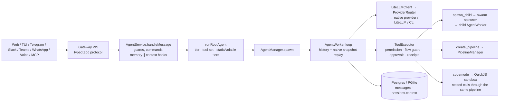

# Architecture, session-cache and plugin review — 2026-11-08

> **Review report.** Revision `d6e9963` (v0.6.0). Static reading of the source,
> plus checks run in a Linux container on Node 24.22.2 with no providers
> configured, so no paid calls were made. Token counts are o200k BPE estimates
> from the repo's own `js-tiktoken`, not provider-exact. Comparison repositories
> were read, not run, at their default-branch HEAD on 2026-11-08: DeepSeek
> Harness, Hermes Agent, Odysseus and Pi. Provider behaviour was checked against
> the vendors' current documentation on the same day (links at the end).

Builds on, and does not repeat:
[session prompt strategy (09-16)](session-prompt-strategy-implementation-2026-09-16.md),
[prompt effectiveness (09-17)](prompt-effectiveness-audit-2026-09-17.md),
[performance audit (10-13)](performance-audit-2026-10-13.md).
Items those reports already list as open are marked *(known)*.

## 1. Verdict

Octipus's cache design is more deliberate than most self-hosted agents'. It
splits the system prompt into a stable tier and a volatile tier, and moves the
volatile tail into the user turn. It replays the native conversation byte for
byte, strips signed reasoning at every edit, keeps tool groups sticky per
conversation, sends affinity keys per provider, and resumes vendor CLI
sessions. In the steady-state tool loop the prefix is stable.

The money and latency are lost at the edges:

1. **What sits in the prefix.** The 26-tool Companion toolbox, about 8.8k
   tokens, has been advertised on every root turn since 2026-11-05. It is 70%
   of the always-kept tool schema.
2. **Events that rewrite the prefix.** Compaction re-reads the history cold,
   in up to ~37 separate calls, and keeps a 500-token summary. Plan mode and
   space write-withholding change the tool list. `tool_choice` flips, and
   tool groups grow mid-conversation.
3. **Scoping that prevents cross-session reuse.** OpenAI keys are per session.
   The "static" tier carries the per-user persona and the per-session
   workspace listing. The docs then conclude that "a cache prefix only helps
   within one [session]". That is a property of this scoping, not of the
   providers.
4. **Local-model plumbing.** Ollama tool loops run on `/v1`, which supports
   neither `keep_alive`, `num_ctx` nor `tool_choice`. Frontier models behind LiteLLM
   or a custom endpoint run the root in *lite* mode, capped at 8 iterations.

The plugin layer is the weakest area. There are four overlapping mechanisms.
The legacy loader has two reproduced bugs, and its documented hot-reload does
not reload code. The extension API can observe a turn but cannot shape one.

Quality is high. Typecheck and lint are clean. About 10k tests pass. The only
non-environmental failure was a timing flake under load, which passes alone.

### Top ten, by impact over effort

| # | Change | Effect | Effort |
|---|---|---|---|
| 1 | Give `companion` an intent trigger, or gate it on Companion being enabled (§5.4 C1) | −8.8k schema tokens on every root request for everyone else; restores the v0.5 standing-prompt gains | S |
| 2 | Compaction as a **cached continuation**: same model, same prefix, append the instruction; structured summary sized to the input (C2) | ~37 cold calls → 1 warm call; far less loss | M |
| 3 | Classify frontier model families by model id whatever the provider (C11) | Claude/GPT via LiteLLM no longer runs a lite root capped at 8 iterations | S |
| 4 | Ollama on native `/api/chat` everywhere, with pinned `num_ctx`, `keep_alive` and a truncation check; a foreground-priority gate per local endpoint (C10, C13) | No silent truncation; model stays warm; background work stops evicting the live conversation's KV | M |
| 5 | OpenAI: key per prefix family, partitioned only above ~15 RPM; `allowed_tools`; `prompt_cache_options.ttl` for GPT-5.6+ (C3, C12) | Cross-session hits on the shared prefix; retention keeps working on new models | S |
| 6 | Anthropic: 1h on tools/system with 5m on history, a tools breakpoint, no `tool_choice` flips (C4, C5) | Cheaper long gaps; fewer message-cache resets | S |
| 7 | Plan mode and space write-withholding as a permission overlay, not tool stripping (C6) | No full-prefix reset on toggle | M |
| 8 | Stub or deduplicate earlier turns' retrieved context (`promptContext`) (C8) | Less context growth; later compaction | M |
| 9 | Plugins: fix the reload bugs; consolidate to two tiers (§7) | A documented feature that works; one model for authors | M–L |
| 10 | Cache-break telemetry: order-sensitive prefix hash; expected vs actual cache reads; local prefill speed (C9) | Regressions like #1 show up in a dashboard, not a review | S–M |

## 2. Method and evidence

| Check | Result |
|---|---|
| `npm run typecheck` | pass, 10 s |
| `npm run lint` | pass, 1,509 files |
| Unit project: 641 files, 7,870 tests | All pass once `mcp-server` is built, except one suite (`websearch/page-content`) that needs a Playwright headless-shell build this container lacks. All 156 first-run failures were `CLI tool bridge is not built`, an unstated prerequisite. |
| Database project: 193 files, 2,389 tests | 2,188 pass, 200 skipped. One failure under load (`federation/visitor-residency`, `timed out waiting for doc.sync`) passes 10/10 alone: a 15 ms polling deadline that is sensitive to CPU contention. |
| Terminal project (`tests/tui`) | not run |
| Prompt and tool weights | measured through the repo's vitest config: role prompts, preamble, delegation prompt, and every built-in tool group's JSON schema |
| Plugin bugs | reproduced with Node 24 directly (§7.2) |

## 3. Architecture

### 3.1 Turn flow



### 3.2 Strengths to keep

- **One loop.** Phase 9 removed the routing hop. Every surface runs the same
  worker, and model routing fails loud.
- **Cache discipline in the loop.** The volatile tail moves into the user turn
  (`agent-worker.ts:621-670`) and is persisted with the row, so it replays
  verbatim (`session-history.ts:160`). Tools stay declared with
  `tool_choice:'none'` once the history references them. Old tool outputs are
  truncated only near the window. The `MCP SERVERS` section is built from
  stored config, so a server dropping its connection does not change the
  prompt (`mcp/servers-section.ts`).
- **Reliability scaffolding.** Receipts, scorer gates, a swarm ledger, durable
  approvals, generation-guarded writes, and fingerprinted CLI resume
  (`cli-session-store.ts`).
- **Code mode.** The `pi-codemode` QuickJS sandbox has a static description and
  sends nested calls through the full permission pipeline (`tools/codemode.ts`).
- **Plugin packages.** Out-of-process MCP servers with declared per-tool
  effects, a protection ceiling, settings and vault-held secrets
  (`plugins/packages/`). This is the right base for the plugin system (§7).

### 3.3 Structural issues

1. **Four prompt builders, one regex.** `root-runner`, `worker-spawner`,
   `direct-response` and the Companion and voice paths each concatenate
   strings. They mark the tier boundary with
   `VOLATILE_MARKER = /\n\nCURRENT DATE ?&? ?\/?\s?TIME/`
   (`prompt-cache.ts:33`). A block pushed to the wrong array silently moves
   across the cache boundary, and nothing measures it per tier per provider.
   Replace this with one `PromptBuilder` whose tiers are typed: install-static,
   user-static, session-static and turn-volatile. Give each tier a fingerprint
   and a token count.
2. **Prompt and data access inside the prompt builder.** `root-runner.ts:563-566`
   carries the Companion controller prompt, about 1.5k tokens, as a single
   inline string. `root-runner.ts:334-340` runs raw Drizzle queries for
   Companion token caps. Every other role keeps its prompt in a `.md` file.
3. **Hot session state in one JSONB column.** The native snapshot, up to 1M
   characters (`session-history.ts:182`), lives in `sessions.context`.
   Postgres rewrites the whole value on every turn
   (`session-repository.ts:262`). The root-turn path has up to 10 full-row
   reads (call sites: 6 in `service.ts`, 3 in `root-runner.ts`, 1 in history),
   plus 2 per spawned child. Use an append-only `conversation_entries` table, which is
   Pi's JSONL tree in SQL, and one request-scoped session read.
4. **Very large files.** `pipeline-manager.ts` (4,123 lines),
   `swarm/spawner.ts` (2,998), `agent-worker.ts` (2,662) and
   `cli-agent-worker.ts` (2,034). The newest Companion code is dense,
   one-line style (`if(!supervisor)staticParts.push(…)`).
5. **Doc drift** (§8).

## 4. Modes, and how to tune each

| Mode | Where it is decided | What changes | Cache or latency issue | Optimisation |
|---|---|---|---|---|
| **Full tier** (≥24B, or an allowlisted cloud provider) | `prompt-tier.ts` | Whole prompt, ~2.2k-token delegation prompt, swarms, pipelines | Fine within a session; the prefix differs per user and session (C3) | Install-wide static layer first; breakpoint layout (C4) |
| **Lite tier** (<24B, *or unknown size on a non-allowlisted provider*) | `prompt-tier.ts:129-152` | Lite prompt, one delegation, `liteMaxIterations: 8` (`root-runner.ts:833`) | LiteLLM, custom and vLLM rows land here even for Claude or GPT (C11) | Classify by model family; read LiteLLM `/model/info` |
| **Small tier** (<10B) | `small-model.ts:39` | 7 tool groups, no lazy discovery, toolshim | Prefill dominates on local hardware; default `num_ctx` 4096 truncates (C10) | Stable minimal prefix; pinned `num_ctx`; one KV slot per agent kind |
| **Lazy tool discovery** | `lazy-tools.ts` | Core set plus `list_tools` and `describe_tool`; long-tail tools called by name | The core set follows the message; each newly used group resets the cache once (C7) | Stable per-role core; inject schemas in the turn, or use Anthropic `defer_loading` and OpenAI `allowed_tools` |
| **Swarm** (`spawn_child`, `parallelGroup`) | `swarm/` | Fresh child conversation; key `child:<role>` | On a one-slot local server each spawn evicts the root's KV, and the root re-prefills on return | `OLLAMA_NUM_PARALLEL≥2` / llama.cpp `id_slot` per agent kind; prefer codemode for fan-out reads |
| **Pipelines** | `pipeline-manager.ts` | Staged children, QA retry | Each stage starts cold, by design | Shared stage prefix (role and tools) ahead of the handoff document |
| **CLI agents** (Claude Code, Codex, …) | `cli-agent-worker.ts`, `cli-adapters.ts` | Vendor loop; `--resume` / `exec resume` | Vendor-managed; Octipus re-sends only the volatile tail | Already good. Keep fingerprints narrow. |
| **Plan mode** | `root-runner.ts:405` | Mutating tools stripped | Entering and leaving resets the whole prefix (C6) | Permission overlay; keep the tool array |
| **Spaces, rooms, federation** | `root-runner.ts:409-430` | Personal-only tools hidden; writes withheld per trigger | Listen turns and user turns alternate tool sets (C6) | Same overlay |
| **Inline UI** (web client) | `root-runner.ts:449` | Extra tool and static block | Switching between web and TUI in one session changes the prefix | Always declare the tool; gate it at call time |
| **Companion** (controller, briefing, maintenance) | `root-runner.ts:563`, `companion/` | Own prompt and tool set | Its tools leak into every non-Companion root turn (C1) | Intent or availability gate; prompt in `.md` |
| **Direct response** (voice propose, interject) | `direct-response.ts` | Toolless and a different system prompt | Breaks history-cache continuity in a mixed session; acknowledged through `historyCache` | Reuse the agent prefix and set `tool_choice:'none'` |
| **Voice telephony fast path** | `voice/telephony` | Direct short-prompt call | Latency-bound | Keep its prompt tiny and stable; warm the model |
| **Heartbeat, cron, hooks** (unattended) | `heartbeat.ts`, `cron-runner.ts` | Background root turns | Wakes compete with live turns on local models (C13); 5m entries expire between wakes | `background` priority; 1h static TTL only when the interval is under an hour (C4); same role core every wake |
| **Protection levels** | `core/protection/` | Forced local model | Same as small and local | Same as small and local |
| **Code mode** | `tools/codemode.ts` | One script, many nested calls | Already cache-friendly | Promote it for multi-read fan-out on local models |

## 5. Session and prompt cache handling

### 5.1 What a root request looks like today

```
tools[]   role groups ∩ sticky per-message core set, + meta-tools,
          list_tools/describe_tool, capabilities, MCP lazy handlers
system    STATIC  preamble+formatting+vault → persona (hook, per user) → role prompt
                  → critical rules → delegation policy + prompt (full) → workspace listing
                  or repo suite (per user/workspace) → space notice → MCP SERVERS → inline-UI
          ── BP1 cache_control (5m, or 1h with cachePolicy=session) ──
messages  [checkpoint summary] [turn 1: promptContext₁ + text] [assistant / tool …] …
          [turn N: promptContextₙ + text]
          ── BP2 on the last message (conversation), or the one before it (one-shot) ──

promptContext = CURRENT DATE & TIME (ms) + memories (≤250 tok) + context hooks (≤2,000 tok)
                + attachments + security reminder + topic hint (lite) + output/plan directives
```

### 5.2 Provider matrix

| Provider | Provider mechanism | What Octipus does | Gap |
|---|---|---|---|
| Anthropic, native (default) | Up to 4 breakpoints; TTL 5m or 1h, mixable if the longer comes first; prefix order tools → system → messages; changing `tool_choice` invalidates message blocks; reads 0.05× on Opus/Sonnet 5.5 | BP on the static system and the last message; one TTL for all | C4, C5; no `defer_loading` tool search |
| Anthropic via OpenAI-compat (`ANTHROPIC_NATIVE_MESSAGES=0`) | No caching | Rollback path only | Docstrings still call native "opt-in" (`anthropic-provider.ts:35,45`) |
| LiteLLM proxy | Forwards `cache_control` | Marks Claude-family ids; `prompt_cache_key` only with `cachePolicy=session` | Tier detection (C11) |
| OpenRouter | Forwards `cache_control` for Claude, Gemini and some Alibaba-hosted models; automatic sticky routing, keyed by a documented `session_id` and *skipped when `provider.order` is set* | `user` = affinity key; its own `provider.order` pin (bounded at 500); Claude-only marking | Mark Gemini and Qwen routes as well. Choose one stickiness mechanism: OpenRouter's `session_id`, or the explicit pin. Today the pin silently turns the built-in mechanism off. |
| OpenAI | Automatic; key-based routing at ~15 RPM per key; `in_memory`/`24h`, replaced by `prompt_cache_options.ttl` (`30m`/`12h`) on GPT-5.6+; `allowed_tools` | Key per session and scope by default (`provider-options.ts:66`); `24h` only with `session`; Chat Completions only | C3, C12; Responses reasoning items *(known)* |
| Gemini | Implicit caching; explicit `cachedContents` | OpenAI-compat endpoint; raw-message replay keeps thought signatures; `cachedContent` only as a manual setting | Managed explicit-cache lifecycle *(known)* |
| DeepSeek, Moonshot, Z.AI | Automatic prefix cache | Stable prefix; hit tokens folded in `usage.ts` | none beyond the shared items |
| Grok, Mistral | Conversation header or key | Per session (`grok-provider.ts:27`, `mistral-provider.ts:23`) | Same granularity question as OpenAI |
| Custom OpenAI-compatible (vLLM, llama.cpp, LM Studio) | Server-side prefix caching (vLLM APC, llama.cpp `cache_prompt` and slots) | No hints sent | `id_slot` per agent kind; tier detection (C11) |
| Ollama | KV reuse of the shared prefix while the model is loaded; `/v1` supports neither `keep_alive`, `num_ctx` nor `tool_choice` | `/v1` for tool loops; native only for `think:false` or JSON (`ollama-provider.ts:156`) | C10 |
| CLI agents | Vendor-managed | `--session-id`/`--resume`, `codex exec resume`, fingerprinted | none |

### 5.3 Model sizes

| Tier | Prompt | Tools | Cache priority |
|---|---|---|---|
| Small (<10B) | Lite role prompt (~0.3–1.2k) plus a ~0.5k preamble | ≤7 groups, full schemas | Prefill time. Keep the prefix minimal **and identical across turns and sessions**, so a one-slot server reuses KV. Pin `num_ctx`. Never toggle tools. |
| Lite (10–24B) | Lite prompt and policy (~2k) | Lazy core | Same as small, plus the swarm's KV-eviction cost |
| Full | ~6k prose + 12.7k–19.4k always-kept or core schema | Lazy core plus tail | Dollar cost. Breakpoint layout, TTLs, cross-session sharing, compaction. |

### 5.4 Findings: cache breakers and missed reuse

**C1. The Companion toolbox rides on every root turn.**
`roles/general/config.ts:31` lists `companion` first in `coreToolIds`. It has
no entry in `INTENT` (`tool-intent.ts:54`), so it "fails open". It is not a
switchable module and has no availability gate; its handlers refuse at call
time instead. Measured: 26 tools, **8,848 tokens**, against 12,695 for all
always-kept root groups and 3,847 for the others. It arrived on 2026-11-05
(`fc352cf`), after the README's 12,357-token standing-prompt figure.
**Fix:** an intent pattern (supervise, goal, incident, briefing, Companion), or
keep it in the long tail unless Companion is enabled for the workspace. The
supervisor path already rebuilds its own tool set (`root-runner.ts:470-473`), so
nothing there needs it in the general core. `monitor` (1,201) and
`connections` (954) deserve triggers too.

**C2. Compaction is cold, multi-call and lossy.** The summary call uses a new
system prompt ("You are a conversation summarizer…") and history serialised to
text (`utils/context-compaction.ts:514-536`). Long inputs are mapped in 8,000
character chunks (`:20`) at 250 tokens each, four at a time, then condensed
recursively and reduced. The result is capped at `maxTokens: 500` and "under
500 words" (`core/context-compaction.ts:127`). A session checkpoint fires at
min(64k, 50% of the window) (`session-compaction.ts:33-34`) and summarises with
the install's **default model** (`:524`). A 64k-token session, about 256k
characters, therefore takes roughly 32 map calls, 4 condense calls and one
reduce: all uncached, all on the default model, for 500 tokens of narrative.
**Fix:** send the summary request as a continuation of the conversation. Use
the same model, tools and system, append the instruction as the last user
message, and the whole history is read from cache, at 0.05–0.1× on current
Claude and GPT models. Use a structured template: goal, constraints and
preferences, decisions, files and state, open problems, next steps. Size the
budget to the removed tokens, for example 1.5–4k. Keep map-reduce only as a
fallback above the window.

**C3. Per-session scoping defeats cross-session reuse, and the docs blame the
providers.** `lazy-tools.ts:16` and `docs/OLLAMA.md:109` say the prefix is
"billed in full on every fresh session since a cache prefix only helps within
one". Hosted caches are prefix-addressed across requests. What makes each
session cold here is that the "static" tier varies per user (persona) and per
workspace or session (listing, repo suite, inline UI); that the tool list
follows the first messages; and that OpenAI's `prompt_cache_key` is derived
from the session (`usage.ts:102`). OpenAI documents that a key "separates cache
reuse between groups of requests" and recommends about 15 RPM per key.
**Fix:** an install-wide layer first (tools, preamble, role, delegation),
cached as its own unit; user and session layers after it. On OpenAI, try a key
per role plus prefix hash, partitioned deterministically only above ~15 RPM.
Hermes keys by content and conversation lineage instead (§9). That keeps
routing stable across compaction but gives up cross-session sharing. On a
low-traffic, single-user install the shared key should win; measured cache
read and write totals decide.

**C4. Anthropic breakpoints are under-used.** `prompt-cache.ts:54` assumes
every breakpoint must share one TTL. The documented rule is only that 1h
entries come before 5m entries. Two of four breakpoints are used and none sits
on the tools. **Fix:** `session` policy → 1h on the static layer, 5m rolling on
history. Add a breakpoint after the tool block when it is above the model's
minimum (512 tokens on the 5.x family; 1,024–4,096 on older models).
Choose the TTL by pacing, as Hermes does (§9). It measured 63% of interactive
cache-write tokens as cold rewrites after 5–60-minute gaps, so it uses 1h for
human-paced sources. Its machine-paced bursts (cron, webhooks, subagents) stay
at 5m, because 1h there cost it +49%. Recurring wakes that share a prefix gain
from 1h only when their interval is under an hour.

**C5. `tool_choice` flips.** When tools are disabled mid-run,
`agent-worker.ts:2488-2512` keeps them declared, which is correct, and sends
`tool_choice:'none'`. Anthropic invalidates message blocks on a `tool_choice`
change, so that final call re-reads the conversation uncached. Ollama's `/v1`
ignores `tool_choice`, so there the flip and the G1 `'required'` escalation do
nothing. **Fix:** keep `auto`; say "answer in text now" in the appended turn;
treat a stray call as text.

**C6. Plan mode and space write-withholding change the tool array.**
`root-runner.ts:405` and `:412` call `stripMutatingTools`. Toggling plan mode,
or alternating listen and user turns in a space, resets the full prefix. On
Claude that also discards the thinking bound to it. **Fix:** keep the array
and deny at the permission layer. The plan directive is already in the
volatile tier. Children can still be denied write tools through the same
overlay. *(Found during implementation: the worker and swarm spawners already
read the session's plan flag and space role and strip their children's set,
which is built once and never flips, so only the root needs the overlay.)*

**C7. Sticky core growth.** Each newly needed group resets the cache once
(`tool-intent.ts:100`). This is bounded at six groups, but it is pure loss on
long sessions. **Options:** a stable per-role core; injecting the matched
group's schemas into the turn (long-tail tools are already callable by name);
or the provider-native forms, Anthropic tool search with `defer_loading` and
OpenAI `allowed_tools` over a stable list.

**C8. Retrieved context accumulates.** Each user row keeps that turn's
`promptContext` and replays it (`session-history.ts:160`). That is right for
byte-stable caching, but thirty turns carry thirty memory blocks and up to
thirty 2k-token hook blocks (`retrieval.ts:51`, `schema.ts:811`). The context
fills, compaction comes sooner, and old snippets compete with new ones.
**Fix:** inject only new memories and snippets; replace earlier turns' blocks
with a one-line stub at the next checkpoint, which already rewrites the
prefix.

**C9. No cache-break visibility.** The prefix fingerprint sorts tools by name
("order alone is not a change", `agent-worker.ts:2136`). That is right for
signed reasoning and wrong for caches, where byte order matters. Cache reads
and writes are shown per session (`web/components/chat/session-cost.tsx`), but
nothing compares expected against actual reads. **Fix:** an order-sensitive
hash per tier, logged on change with the reason (tools, system layer or
model). Add a "should have hit" alarm: the same prefix hash, `cache_read`
under 50% of the prefix, within the TTL. For Ollama, record
`prompt_eval_duration` per token, because `prompt_eval_count` reports total
prompt size, not reuse.

**C10. Ollama plumbing.** Tool loops go through `/v1`. Agent workers strip
`think`, and the native branch at `ollama-provider.ts:156` serves only
`think:false` and JSON mode, so a tool loop never takes it. The
official compatibility page lists no `keep_alive`, no `num_ctx` and no
`tool_choice`. *(Corrected during implementation: Octipus does attach the
configured `ollama.keepAlive` to `/v1` requests (`ollama-provider.ts:744`),
and current Ollama honours it there; it is undocumented, not absent. The
`num_ctx` half of this finding stands.)* Octipus also plans with the model row's window, e.g.
40,960 (`agent-manager.ts:305`), while Ollama allocates its default 4,096
unless the operator sets `OLLAMA_CONTEXT_LENGTH`, so the prompt is truncated
silently, against the "fail loud" rule. `docs/OLLAMA.md:105` says local prefill
"re-runs every request (no cross-request server-side prompt caching)", but
Ollama reuses the KV of the shared prefix while the model is loaded. That makes
prefix stability *more* valuable locally, not less. **Fix:** use `/api/chat` for
every call, with `options.num_ctx` pinned per model so it never changes and
never reloads the model, and with `keep_alive` always sent. Probe `/api/show`
once. Fail loud when the standing prompt plus a reserve exceeds the allocated
context. Use `format` for JSON.

**C11. Frontier models behind a proxy run as lite.** For an unknown size,
`resolvePromptTier` returns `lite` unless the provider is on an allowlist
(`prompt-tier.ts:45,144`). `isSmallModel` returns *not small* for the same
model (`small-model.ts:41`). Only the hwfit installer writes `paramCount`. A
`claude-sonnet-…` or `gpt-5…` row on `litellm`, `custom-openai` or
`custom-anthropic` therefore gets the lite prompt, one delegation and 8
iterations. **Fix:** classify by model family (`isAnthropicFamily` already
exists; add gpt-4.1/5/o-series, gemini, deepseek, grok, kimi, glm,
mistral-large, qwen-max). Read LiteLLM `/model/info`, which carries
`max_input_tokens` and `supports_function_calling`. Log the tier and its
reason in the status bar.

**C12. GPT-5.6+ retention.** OpenAI replaced `prompt_cache_retention` with
`prompt_cache_options.ttl` (`30m`/`12h`), and writes there are priced at
1.25× or 2.5×. `provider-options.ts:74` still sends `24h`. The retry-without
logic then silently drops the extended retention. **Fix:** a capability-keyed
mapping, and cache-write pricing for those models in `cost-tracker.ts`.

**C13. Background work competes with the live turn on local models.** The
provider rate limiter queues `interactive` before `background`
(`rate-limiter.ts:146,192`). But every call site acquires with the default
priority (`providers/index.ts:273,365`), so nothing is ever `background`.
Several kinds of work can share a single local GPU with the user's turn:
memory extraction (fired after each turn), the ~37-call compaction map, the
decision model, the toolshim, heartbeat and monitor wakes. Each of them
evicts the conversation's KV prefix and delays its first token. **Fix:**
derive the priority from the `requestType` that callers already set
(`compaction`, `compaction-map`, …). For local endpoints add a per-endpoint
gate, as Odysseus does (§9): the foreground cancels in-flight background calls,
and background work waits for a quiet period after the stream ends.
*(Found during implementation: agent turns did not pass through the router's
rate limiter or its request metrics at all, only direct router calls did. Both
the priority gate and `recordLlmRequest` now sit in the instrumented provider
wrapper, which every call crosses.)*

## 6. Prompt generation

### 6.1 Measured weights (o200k)

| Piece | Tokens |
|---|---|
| `SECURITY_PREAMBLE` + `OUTPUT_FORMATTING_RULES` (+ vault guidance), on every role | 393 + 92 (+ vault) |
| Root (`general`) role prompt: full / lite | 2,288 / 1,123 |
| Delegation prompt (full tier only) + policy: full / lite | 2,242 + 317 / 286 |
| Other role prompts: full / lite | 421–1,644 / 289–1,167 |
| All 38 built-in tool groups | 47,967 |
| Root role, all 26 groups / 12 core / always kept / always kept without Companion | 31,589 / 19,381 / 12,695 / 3,847 |
| Heaviest groups | companion 8,848 · github 3,139 · google-workspace 3,115 · artifacts 2,936 · browser-ext 2,571 · microsoft365 2,468 |

The root's prose static tier is about 6k tokens before persona and workspace.
Schemas still dominate, exactly as `lazy-tools.ts` says.

### 6.2 Quality

- **Good:** concrete routing within each role; honest-reporting rules; verify
  once and quote the exit code; lite variants for every role; module-aware
  stripping (`core/modules/prompt.ts`); persona kept out of children;
  untrusted MCP descriptions sanitised to one line.
- **Benchmark fitting in the generic root prompt.** The CODING section of
  `general/prompt.md` is tuned to a Python arena: `python3 -m unittest`, "a
  dataclass is a dataclass, not a NamedTuple", "deletion needs an approval you
  cannot get here, so never try". Move it to the coding role, or to a skill
  that loads on intent.
- **Incident accretion.** Many prompt lines are post-mortem rules. Without an
  eval tied to each one, they only accumulate. Tag each rule with the eval case
  that justifies it, and prune rules whose cases pass without them.
- **No model-family variants.** Only size tiers exist. Cheap wins include XML
  sectioning for Claude, a `developer` role for GPT-5 on Responses, and
  stripping the "think step by step" style lines for reasoning models.
- **Inline Companion prompt.** About 1.5k tokens in code (§3.3) cannot be
  reviewed, diffed or measured like the role `.md` files.

## 7. Plugin and extension system

### 7.1 What exists

| Mechanism | Location | Contributes | Isolation | Notes |
|---|---|---|---|---|
| Legacy plugins (`plugin.json` + `index.ts`) | `<cwd>/extensions/*` (`plugins/loader.ts:18`) | Tools, with a flat parameter schema | None: in-process, full Node privileges | `apiVersion` 1.0.0; vault injection disabled because handlers are untrusted code that already runs in-process |
| Extensions (`*.ts` factory) | `~/.octipus/extensions`, `<cwd>/.octipus/extensions` | Event *observers*, slash commands, toasts | None | Cannot register tools, intercept calls, or touch the prompt or context |
| Plugin packages (`octipus-plugin.json`) | `plugins/packages/` | MCP tools with declared effects, settings, secrets, a protection ceiling | Subprocess with a sandbox root | `network` hosts declared, but enforced only as a boolean (`service.ts:369`) |
| External MCP | `mcp-servers.json`, `/api/mcp` | Tools, resources, prompts | Subprocess or remote | Circuit breaker; exposure modes |
| Skills, connectors, personas, roles | various | Knowledge, OAuth, voice, role rows | n/a | Skills follow agentskills.io and are found in many directories |

The names are inverted: the `extensions/` directory holds *plugins*, and
*extensions* live in `.octipus/extensions/`. `AGENT.md` says plugins load from
`OCTIPUS_HOME`; the code uses `process.cwd()`.

### 7.2 Reproduced defects

| # | Defect | Evidence | Fix |
|---|---|---|---|
| P1 | **Hot reload does not reload code.** `reloadPlugin` re-imports the same URL (`loader.ts:88`), and Node's ESM cache returns the old module, so only `plugin.json` changes take effect. | Node 24: first import `v1`; re-import after the edit `v1` (same module object); cache-busted URL `v2` | ``importModuleAt(entryPath, `v=${Date.now()}`)``. `importModuleAt` already takes a query. Document that old instances stay in memory. |
| P2 | **The reload route fails on the shipped example.** It reads `plugin.manifest.tools.length` (`routes/plugins.ts:96`), but the SDK returns the manifest unnormalised (`plugin-sdk/index.ts:177`) and the example declares only `capabilities.tools`. | `validateManifest(example)` → ok, `manifestTools` = 2, `manifest.tools` = undefined → `TypeError` *after* re-registration | `manifestTools(...)`; make `tools` optional in the type, or normalise in `validateManifest` |
| P3 | A failed reload loses the plugin and still returns 200 with `{error}` | `loader.ts:187-195` shuts the old module down and deletes the entry before loading the new one; the route catches and returns a body | Load first, swap on success, set an error status |
| P4 | Declared `capabilities.commands` and `events` are never read | No consumer in `src/` | Wire them to the extension API, or remove them from the contract |
| P5 | A plugin tool error comes back as a successful `{error}` result (`plugin-tool.ts`) | Receipts and audits count it as success | Rethrow, so the executor records a failed call |

### 7.3 Target design

Two tiers, with one manifest that names its tier:

1. **Untrusted: plugin packages (MCP, out of process).** The default for tools.
   Keep declared effects, protection and secrets. Enforce `network` per host
   through a CONNECT proxy or egress allowlist on the sandbox. Add signing and a
   lockfile with hashes; signing is already on the roadmap.
2. **Trusted: in-process extensions with real hooks.** This follows the shape
   of Pi's extension events (§9): `before_agent_start` (system prompt),
   `context` (transform messages before the request), `tool_call` (block or
   rewrite), `tool_result` (redact or annotate), `session_before_compact`
   (custom summariser), plus `registerTool`, `registerCommand` and
   `registerProvider`. The internal `before-agent-start` hook already exists
   (`agent/hooks.ts`), so this mostly means exposing it with typed, versioned
   events. Gate the tier behind an explicit admin "trust" step, because these
   run with full privileges.
3. Deprecate the legacy `plugin.json` tool loader into the package format, and
   ship a converter.

## 8. Quality and drift

- Tests and lint: see §2. The suite needs `mcp-server/dist`. Add a
  `pretest` build or a fixture so a clean checkout is green.
- Code health: 177 explicit `any`s outside tests (the house rule says "no `any`
  in new code"); 131 lines over 400 characters, concentrated in `seed-skills`,
  `commands/plan`, `pipeline-manager` and Companion; 458 bare `catch {}`, most
  of them legitimate parse or readdir fallbacks.
- Doc drift found:
  - `anthropic-provider.ts:35,45`: native Messages is the default, not
    "opt-in", and the class does not call the OpenAI-compat endpoint by
    default.
  - `docs/OLLAMA.md:105,109` and `lazy-tools.ts:16`: the caching claims in C3
    and C10.
  - `AGENT.md`: plugins load from `OCTIPUS_HOME` (they load from the cwd).
  - `docs/PLUGINS.md:88`: hot reload (P1).
  - README: the 12,357-token standing-prompt figure (C1).
  - `docs/AGENT-ARCHITECTURE.md`: steering "as a system-level message" (it is
    appended as a `user` turn before the next call:
    `gateway/message-handler.ts:117`, `agent-worker.ts:2616`).

## 9. Comparison with DeepSeek Harness, Hermes Agent, Odysseus and Pi

Revisions read: DeepSeek Harness `fcc0ad46` (v0.2.2-rc.1), Hermes Agent
`48c7a09f`, Odysseus `1c15090` (`dev`, harness 0.20.19), Pi `e49b149` (v1.5.0).
The claims below were checked in their code, not only in their docs. Where a
project delegates to a library it does not vendor, that is marked. The full
per-project studies, with `file:line` references into each project, are in
[architecture-review-2026-11-08/](architecture-review-2026-11-08/README.md).

### 9.1 At a glance

| | Octipus | DeepSeek Harness | Hermes Agent | Odysseus | Pi |
|---|---|---|---|---|---|
| Shape | TS platform, Postgres/PGlite, many channels | TS; everything is a Cordis plugin; web, headless, SDK, ACP | Python; gateway, CLI/TUI, desktop; SQLite + FTS5 | Python FastAPI; 17k-line loop function; SQLite | TS minimal core plus extensions; JSONL session tree |
| Volatile context | Appended to **every** user turn and persisted (ms timestamp, memories, hook snippets) | User-role runtime snapshot, appended **only when it changes**; clock at most every 10 min | Date-only stamp from session birth; memory snapshot frozen; recall appended to the user turn and persisted; skills-index **deltas** | Timestamp as a tail message, but memory, RAG and web results **before** history | No date in the prompt; volatile values as bash environment variables |
| System prompt across turns | **Rebuilt every turn** from live state | Static node 0; changes appended in history on capable routes | Built once, **persisted and replayed verbatim**; rebuilt on identity change or compaction | Rebuilt; mid-run system nudges hoisted to index 0 | Stored in the transcript; named-section diffs appended |
| Tool list changes | Sticky growth **inserted in role order**; plan mode strips tools | `tool-addition` / `tool-removal` deltas; **plan mode keeps tools "for request-cache stability"** | Bytes and order pinned; new tools **appended at the tail**; breaks only on explicit request | Top 8 retrieved per turn, so it changes every turn | Deltas, plus a deferred placeholder tool declared from turn 1 |
| Anthropic breakpoints | Static system + last message; one TTL | Through pi-ai | Static tier + full system or `tools[-1]` + last 2 transaction ends; **TTL by pacing** | System + last tool; none in history | System, last tool, last message; 1h opt-in |
| OpenAI cache key | Session + scope; 24h opt-in; Chat Completions only | Through pi-ai (session id) | Content-addressed: hash of scope, static system and tools, per lineage | none | Session id; GPT-5.6 `prompt_cache_options`; Responses with encrypted reasoning |
| Compaction | Separate summariser, map-reduce, **500-token** narrative, cold | **Replays the warm prefix plus a trailing instruction**; fixed headings | The only sanctioned prefix break; structured, **2–10k tokens**, verbatim user messages, anchor index | Utility model; structured, 1,024 tokens | Structured, iterative, cold (serialised text) |
| Local models | `/v1`; no `keep_alive`/`num_ctx`; no foreground priority | none | `num_ctx` from `/api/show`, sent per request; no `keep_alive` | `session_id` + `cache_prompt` to llama.cpp; **foreground gate**; KV regression tests | none |
| Cache telemetry | Read/write totals per session | Hit % per session and turn; reasons on request headers; **real-API cache e2e** in CI | Hit % per call; **break-cause classification** and unannounced-miss detection | One log line | **Re-billed dollars** per turn; miss notices; value-based cache warming |
| Plugins | Four mechanisms; observe-only extensions | Profiles, bundles and patches; scoped registries; HMR; no trust model | `plugin.yaml` kinds, ~40 hooks, middleware; optional host-process isolation; SHA-pinned catalog | No in-process plugins; MCP, REST integrations, skills | 41 extension events; npm/git packages; jiti hot reload; project trust |
| Subagents and cache | Role children, fan-out started concurrently (all cold) | Fork children with a byte-identical prefix | Cache-parity forks; **leader-first sibling gate** | Fresh-context verifier | Separate processes, no sharing |

### 9.2 What to adopt, mapped to the findings

1. **Persist and replay the static tier and the tool bytes** (Hermes,
   DeepSeek Harness node 0, Pi transcript). Rebuild them only at compaction,
   an identity change or an explicit refresh. Octipus already persists the
   volatile tail (as Hermes's `api_content` does) and the native conversation;
   the system and tool bytes are the missing third piece. This fixes the drift
   sources in C3 and C6: workspace listing, repo scans, persona edits.
2. **Deltas instead of rewrites** (DeepSeek Harness `systemPromptUpdate` and
   `toolUpdate`; Pi `tool_addition`/`tool_removal` with a deferred placeholder;
   Hermes skills-index deltas). Until Octipus has provider-native deltas,
   append newly needed tools at the **tail**, never in role order (C7), and keep
   plan mode out of the tool array (C6).
3. **Compaction on the warm prefix** (DeepSeek Harness), with Hermes's
   structured, size-proportional summary: verbatim user messages, an anchor
   index of SHAs, paths and errors, recovery pointers (C2).
4. **TTL by pacing** (Hermes, measured) and no breakpoints on one-shot calls
   (C4). Octipus already does the second.
5. **Leader-first fan-out** (Hermes `delegate_tool_prefix_gate`). Start one
   sibling of a `parallelGroup`, wait for its first streamed chunk, then start
   the rest, so they read the role prefix that sibling just wrote. Today the
   `child:<role>` scope exists for exactly this sharing, but concurrent starts
   all write cold.
6. **Cache-parity forks** (DeepSeek Harness fork children; Hermes background
   review, about 26% cheaper). Same-role helpers, background reviews and
   learning passes can inherit the parent prefix byte for byte instead of a
   fresh role prompt.
7. **Cache telemetry and regression tests**: Hermes break-cause
   classification; Pi dollar-denominated misses; DeepSeek Harness real-API
   `cacheReadTokens > 0` tests; Odysseus KV-invalidation tests; Hermes
   committed prompt-surface snapshot in CI, which would have caught C1 in
   review (C9).
8. **Local-model hygiene**: Odysseus foreground gate and post-idle side jobs;
   Hermes `num_ctx` from `/api/show`; llama.cpp `id_slot` and `cache_prompt`
   for custom endpoints (C10, C13).
9. **Volatile hygiene**: the DeepSeek Harness snapshot-on-change; the Hermes
   date-only stamp and frozen memory snapshot, refreshed at compaction (C8).
10. **Plugin surface**: Pi's event list and jiti `moduleCache:false` reload,
    which is the fix for P1; Hermes's optional host-process isolation and
    pinned catalog; DeepSeek Harness's profile and patch layering (§7.3).
11. **Strategic option: pi-ai as a provider substrate.** DeepSeek Harness uses
    `@earendil-works/pi-ai` for every non-DeepSeek route, and Octipus already
    ships `pi-tui` and `pi-codemode`. One pi-ai adapter behind Octipus's
    `ModelProvider` interface would bring Responses with encrypted reasoning,
    GPT-5.6 cache options, tool and effort deltas, Bedrock `cachePoint`, compat
    flags such as `cacheControlFormat` for LiteLLM, and a model catalog with
    capability flags. Octipus's routing, personal keys, protection levels and
    cost ledger would stay. The costs: a fast-moving dependency that uses beta
    APIs (DeepSeek Harness carries a local patch for O(n²) streaming JSON), and
    a second error taxonomy to map.

### 9.3 Where Octipus is ahead

- **Authority model.** ALLOW/ASK/DENY with durable approvals, flow guard,
  protection levels and the vault. Pi has no permissions. DeepSeek Harness and
  Hermes plugins default to full in-process trust. Only Odysseus's
  taint-gated approvals are comparable.
- **Money.** A cost ledger with cache read and write pricing, plus spend
  budgets. DeepSeek Harness has no USD accounting, and Odysseus prices without
  cache tiers.
- **Vendor CLIs as root models**, with fingerprinted resume. DeepSeek Harness
  runs Codex and Claude Code only as one-task subagents.
- **Privacy posture.** No default data egress, whereas DeepSeek Harness's
  `dsh_session_log` uploads session logs to DeepSeek by default.
- **Retrieval placement.** Retrieved context already sits in the user turn,
  after history; Odysseus puts it before history. The verbatim volatile tail is
  already persisted, as in Hermes.
- **Reliability scaffolding.** Receipts, scorer gates, the swarm ledger, and
  code mode plus lazy discovery in core.

## 10. What could be faster

- **Time to first token.** Before the model call a root turn awaits, in
  sequence: memory retrieval (an embedding and a vector search, run in
  parallel with context hooks); up to 10 session-row reads; the Companion cap
  query; MCP initial connect; the sticky tool-group write; the persona hook;
  the repo graph or workspace listing; the spawn writes; and history plus
  snapshot load. Instrument these phases with the existing run-trace spans,
  then read the session once per request and overlap the independent awaits.
- **Local inference.** Pinned `num_ctx`, `keep_alive` and a stable prefix turn
  re-prefill into reuse. Separate KV slots for root and children stop the
  swarm evicting the root. Dropping Companion takes 8.8k tokens out of every
  local root prefill. Code mode collapses multi-read chains into one round trip.
- **Compaction.** One warm call instead of about 37 cold ones (C2).
- **Database.** A snapshot table instead of rewriting the JSONB row on every
  turn (§3.3).
- **Hosted cost.** C1, C3, C4 and C7 together decide whether the ~13–19k-token
  schema block costs 1.25× (a write) or 0.05–0.1× (a read) on the first
  request of most sessions.

## 11. Roadmap

**This week (S):** C1, C11, C12, the C4 TTL split, P1–P3 and P5, doc drift,
and the test prerequisite.

**Next (M):** C2 (cached structured compaction), C10 and C13 (native Ollama,
foreground gate), C6 (permission overlay), C9 (telemetry), C3 (key
granularity and layered static tier), C5.

**Then (M–L):** persist and replay the static tier and tool bytes per
conversation (§9.2 item 1). Then C7 and C8 (tail-appended tools, deduplicated
retrieval), leader-first fan-out and cache-parity forks (§9.2 items 5–6), the
`PromptBuilder` and snapshot table (§3.3), and the plugin consolidation (§7.3).
Evaluate pi-ai as the provider substrate (§9.2 item 11) before building OpenAI
Responses and Gemini explicit caches *(known)* by hand.

Measure each change before and after with `cache_read` / `cache_creation`
totals per session and time to first token, over a fixed session mix: short
chats, a long tool loop, a plan-mode toggle and an overnight heartbeat.

### Implementation status (branch `ccr-c3873536-snjite`, PR #467)

| Finding | Status | Where |
|---|---|---|
| C1 intent gating for `companion`, `monitor`, `connections` | done | `tool-intent.ts` |
| C2 compaction as a continuation of the warm prefix, sectioned, sized to what it replaces | done | `utils/context-compaction.ts` |
| C3 OpenAI key per prefix family, partitioned above ~15 RPM | done (key granularity). The layered install-wide static tier is still open. | `providers/prompt-cache-key.ts` |
| C4 1h prefix / 5m history on attended turns; tools breakpoint | done | `providers/prompt-cache.ts`, `anthropic-provider.ts` |
| C5 no `tool_choice` flip on the final call (Claude) | done | `agent-worker.ts` |
| C6 plan mode and space write-withholding as a call-time refusal on the root | done | `tool-executor.ts`, `root-runner.ts` |
| C7 new groups appended after earlier ones; on first-party Claude, every tool sent with the long tail deferred behind Anthropic's tool search (`agent.nativeToolSearch`), so the tool block never changes in a conversation | done. OpenAI `allowed_tools` is still open. | `tool-intent.ts`, `tool-split.ts`, `providers/tool-search.ts` |
| C8 unchanged retrieved blocks not replayed | done | `agent/repeated-context.ts` |
| C9 order-sensitive prefix signature, `octipus_prompt_cache_breaks_total` | done | `models/cache-break.ts` |
| C10 native `/api/chat` with pinned `num_ctx`, fail loud on overflow | done | `ollama-provider.ts` |
| C11 frontier families never lite | done | `prompt-tier.ts` |
| C12 `prompt_cache_options.ttl` on GPT-5.6+ | done | `provider-options.ts` |
| C13 background priority, local-runner foreground gate | done | `rate-limiter.ts`, `local-gate.ts` |
| P1–P3, P5 plugin reload and manifest fixes | done | `plugins/loader.ts`, `api/routes/plugins.ts` |
| Leader-first fan-out (§9.2 item 5): siblings of one role and lane start after the first one's first streamed chunk, capped at 20 s | done | `swarm/leader-first.ts` |
| Cache-parity forks (§9.2 item 6): `spawn_child` with `fork: true` continues the parent's conversation on its model and tools; never for an independent child (reviewer, verify lane, maintenance review) | done | `swarm/fork.ts`, `agent-worker.ts` |
| Typed `PromptBuilder` (§3.3 item 1): install, user, session and turn tiers with a fingerprint and token count each; a wider tier after a narrower one throws, a static block carrying the date marker is escaped. Root and worker prompts use it (the worker's pipeline run-scope block had landed after the date line) | done (#469) | `agent/prompt-builder.ts` |
| Persisted static tier (§9.2 item 1): the drifting session blocks (workspace listing, repo suite, AGENTS.md excerpt) are replayed per conversation while the session tier keeps its shape; a clear, a checkpoint, a shape change or `scan_repos` rebuilds them | done (#469) | `SessionContext.staticPrompt` |
| Plan mode refuses git, GitHub and GitLab writes (an allowlist of reads), at every delegation depth; `capabilities` names the refused tools | done | `tool-executor.ts` |
| Direct-response prompt on `PromptBuilder`; its user profile moved out of the per-turn tail (it was replayed once per turn); the cache-break signature ignores deferred tools | done | `agent/direct-response.ts` |
| Native conversation snapshot in its own column (§3.3 item 3, first step): small context patches no longer rewrite it; same row, so the generation guard still covers both | done | `sessions.native_conversation`, migration 0172 |
| pi-ai evaluation (§9.2 item 11): do not replace the provider layer; at most a pinned adapter for OpenAI Responses, measured against the current path | done | [pi-ai evaluation](pi-ai-evaluation-2026-11-08.md) |
| OpenAI `allowed_tools`; the persona after the role template | decided against for now: `allowed_tools` sends the whole ~16k-token schema block on every request where the lazy set sends a few thousand; moving the persona shares the template only across users of one install and moves the identity text | — |
| Persisted tool bytes; the Companion builder on `PromptBuilder`; the remaining session-row reads (§3.3 item 3); plugin consolidation (§7.3) | open | §3.3, §7.3, §9.2 item 1 |

### References

- Anthropic, prompt caching: https://platform.claude.com/docs/en/build-with-claude/prompt-caching
- OpenAI, prompt caching: https://developers.openai.com/api/docs/guides/prompt-caching
- Ollama, OpenAI compatibility: https://docs.ollama.com/api/openai-compatibility
